<p align="center">
  
</p>

<p align="center">


</p>

# 🛡️ Auditoria LGPD Brasil

> Revisão de **projetos de software** quanto à LGPD, com evidências, riscos e plano de correção, para decisão de um profissional.

Criado por **[Lucas Barkoski](https://github.com/Barkoski)**.

**Explore:** [🧩 O que entrega](#o-que-entrega) · [📦 Instalação](#instalacao) · [🚀 Como usar](#como-usar) · [🔒 Dados e permissões](#dados) · [🚧 Limites](#limites) · [📚 Arquivos](#documentacao)

<p align="center">
  
</p>

## 🛡️ O que é

É uma *skill*: um roteiro de trabalho que orienta a IA a auditar um projeto de software (site, app, SaaS) quanto à Lei Geral de Proteção de Dados. A IA lê o código e os documentos que você autorizar, cruza com fontes oficiais e entrega um relatório com o que encontrou, o que não conseguiu verificar e o que corrigir primeiro.

**Para quem é:** advogados, desenvolvedores e responsáveis por projetos que querem uma revisão de privacidade antes de lançar ou ajustar um sistema. O resultado é material de trabalho para revisão profissional, não um parecer pronto.

<a id="o-que-entrega"></a>
## 🧩 O que a revisão entrega

| Etapa | Resultado |
|---|---|
| 🗺️ Inventário | Quais dados pessoais o projeto trata e por onde eles passam |
| 📋 Cobertura | Verificação em 20 áreas (LG01 a LG20), com justificativa para o que não se aplica |
| 🔍 Varredura | Um script, só de leitura, aponta segredos, rastreadores, coleta de dados, arquivos esquecidos e o que vai no pacote de publicação. Valores aparecem mascarados |
| 🔎 Achados | Evidência, risco e grau de confiança de cada ponto; o que não foi verificado fica registrado como pendente |
| 🧭 Decisões do dono | Até 12 perguntas simples sobre o que o código não responde (responsável, base legal, retenção, fornecedores etc.) e minutas feitas só com as respostas dadas |
| 🛠️ Plano de ação | Correções em ordem de prioridade, para decisão dos responsáveis |

<a id="instalacao"></a>
## 📦 Instalação

### No Claude Code (como plugin)

Dentro de uma sessão do Claude Code, digite:

```text
/plugin marketplace add Barkoski/barkoski-auditoria-lgpd
/plugin install barkoski-auditoria-lgpd@barkoski
```

Para atualizar depois: `/plugin marketplace update barkoski`.

### Copiando a pasta

1. Clique em **Code → Download ZIP** e extraia.
2. Copie a pasta `skills/auditoria-lgpd-br` para a pasta de skills do seu ambiente. No Claude Code, é `%USERPROFILE%\.claude\skills\` (Windows) ou `~/.claude/skills/`.
3. Abra uma nova sessão.

### No claude.ai (site ou app)

1. Compacte a pasta `skills/auditoria-lgpd-br` inteira em um `.zip`, com o `SKILL.md` dentro dela.
2. Envie em **Personalizar → Skills → Enviar skill**.
3. Deixe a execução de código ativa nas configurações.

O script de varredura ainda não foi testado no claude.ai. Se ele não rodar, a skill segue o roteiro manual de [padrões de varredura](skills/auditoria-lgpd-br/references/padroes-varredura.md).

**Varredura automática:** precisa de Python 3.9 ou mais novo. Sem Python, a skill usa o mesmo roteiro manual.

<a id="como-usar"></a>
## 🚀 Como usar

Abra uma sessão na pasta do projeto e peça, por exemplo:

```text
Use auditoria-lgpd-br para revisar este projeto sem alterar o código.
Apresente evidências, riscos, limites de acesso e plano de correção.
Não acesse produção nem envie dados privados para pesquisas.
```

No Claude Code, com o plugin instalado, também dá para chamar direto: `/barkoski-auditoria-lgpd:auditoria-lgpd-br`.

Ao final, se faltarem decisões suas (por exemplo, por quanto tempo guardar os dados), a skill oferece o passo **Decisões do dono**. Ela só segue se você disser que sim.

**Boas práticas:**

- Indique só projetos e ambientes que você tem autorização para revisar.
- Prefira dados fictícios e documentos sem informações reais de pessoas.
- A skill não dá acesso a bancos, repositórios ou produção. Ela não deve rodar testes quando não for possível isolar o ambiente.

<a id="dados"></a>
## 🔒 Dados e permissões

**O que tem no pacote:** instruções, referências e um script Python de varredura ([`varredura.py`](skills/auditoria-lgpd-br/scripts/varredura.py)). Não há hooks, servidores MCP, telemetria nem serviço do autor. O autor não recebe nenhum dado por meio deste pacote.

**O que o script faz e não faz:**

- usa só a biblioteca padrão do Python;
- apenas lê arquivos e não acessa a internet;
- não executa nada do projeto. O único programa externo é o `git`, só para leitura, para saber se arquivos `.env` estão versionados (sem git, essa checagem é pulada);
- mascara segredos e dados pessoais na saída;
- recusa gravar o resultado dentro do projeto auditado.

Leia o script antes de executá-lo.

**O que a IA pode ver:** durante o uso, ela pode ler código e dados pessoais que estejam nos materiais que você autorizou, e criar relatórios no seu computador. O processamento pelo modelo segue as regras da plataforma e da sua conta. O plugin **não** garante execução local, ausência de retenção nem apagamento automático do histórico.

**Pesquisas e relatórios:**

- Pesquisas de legislação devem usar só termos genéricos e fontes oficiais, sem material privado.
- Relatórios devem trazer evidências mínimas e mascaradas, guardadas em local restrito. Nunca são publicados automaticamente.
- Os relatórios ficam onde você escolher até que você os apague. O plugin não tem armazenamento próprio nem prazo de guarda.

**Público:** feito para profissionais e responsáveis por projetos, não para crianças ou adolescentes. Pode examinar projetos que tratem dados de menores, com cuidados específicos e revisão humana.

<a id="limites"></a>
## 🚧 Limites

- **Versão candidata 0.2.0.** A revisão estática está registrada no projeto. Testes de comportamento e a validação no portal ainda estão pendentes. Não há aprovação da Anthropic.
- **Não é certificado nem parecer.** O resultado não é parecer jurídico definitivo nem garantia de segurança ou de conformidade.
- **Nenhum achado não prova conformidade.** A revisão deve dizer quais ambientes e documentos não foram acessados.
- **Instrução não é trava.** Regras escritas para a IA não substituem sandbox, permissões mínimas e supervisão humana.
- **Fontes datadas.** A pesquisa-base é de 22/10/2026. O texto literal dos dispositivos mais usados foi capturado em 14/10/2026. As fontes precisam ser conferidas de novo em cada auditoria, seguindo a cadeia de fontes do `SKILL.md`.
- **Dois guias da ANPD** (cookies e legítimo interesse) não tiveram o texto integral obtido na pesquisa. A limitação está descrita em [fontes e critérios](skills/auditoria-lgpd-br/references/fontes-e-criterios.md).

<a id="documentacao"></a>
## 📚 Arquivos

- [Instruções da skill (SKILL.md)](skills/auditoria-lgpd-br/SKILL.md)
- [Referências: matriz, fontes, dispositivos, modelo de relatório, decisões do dono](skills/auditoria-lgpd-br/references/)
- [Script de varredura](skills/auditoria-lgpd-br/scripts/varredura.py) e [projeto-isca com testes](skills/auditoria-lgpd-br/evals/)
- [Metadados do plugin](.claude-plugin/plugin.json)
- [Mudanças por versão (CHANGELOG)](CHANGELOG.md)

## 📜 Licença

Copyright 2026 Lucas Barkoski. Distribuído sob a [Apache License 2.0](LICENSE). Textos normativos não são apresentados como criação do autor. Não há afiliação, aprovação ou endosso da ANPD, da Anthropic ou da OpenAI.
