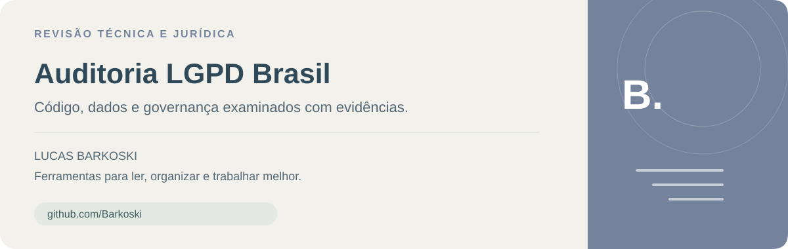
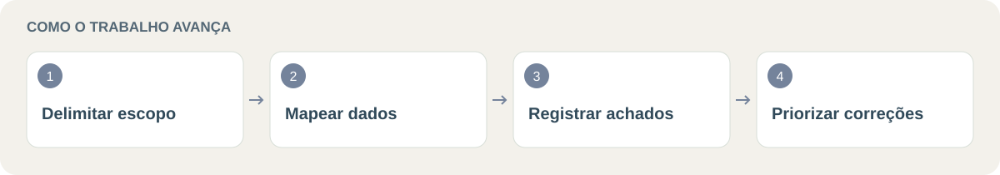

<p align="center">
  
</p>

<p align="center">


</p>

# 🛡️ Auditoria LGPD Brasil

> Apoio à **auditoria técnica e jurídica de software**, com escopo definido, evidências e plano de correção para revisão profissional.

Criado por **[Lucas Barkoski](https://github.com/Barkoski)**.

**Explore:** [📚 Documentação](#documentacao) · [🧩 O que a revisão entrega](#secao-1) · [📦 Começar sem terminal](#secao-2) · [💡 Exemplo de pedido](#secao-3) · [🚧 Conteúdo e limites](#secao-7)

<p align="center">
  
</p>

<a id="secao-1"></a>
## 🧩 O que a revisão entrega

| Etapa | Resultado |
|---|---|
| 🗺️ Inventário | Tratamentos e fluxos de dados identificados no escopo |
| 📋 Cobertura | Matriz organizada em 20 áreas |
| 🔎 Achados | Evidências, riscos e pontos não verificados |
| 🛠️ Plano de ação | Correções priorizadas para decisão dos responsáveis |

<a id="secao-2"></a>
## 📦 Começar sem terminal

1. Baixe o ZIP em **Code → Download ZIP** e extraia.
2. Copie `skills/auditoria-lgpd-br` para a pasta de skills do ambiente compatível.
3. Inicie uma nova sessão e indique expressamente o projeto e os materiais autorizados.

Para instalação como plugin, o pacote inclui `.claude-plugin/plugin.json`. A validação do pacote no ambiente de destino continua necessária.

<a id="secao-3"></a>
## 💡 Exemplo de pedido

```text
Use auditoria-lgpd-br para revisar este projeto sem alterar o código.
Apresente evidências, riscos, limites de acesso e plano de correção.
Não acesse produção nem envie dados privados para pesquisas.
```

<a id="secao-4"></a>
## 🚧 Estado do pacote

Versão candidata **0.1.0**, sem aprovação alegada pela Anthropic. A revisão estática é registrada no projeto; testes comportamentais e validação no portal continuam pendentes. O resultado não é certificado, parecer jurídico definitivo ou garantia de segurança e conformidade.

<a id="secao-5"></a>
## 🚀 Uso

Depois de instalar, peça: “Use auditoria-lgpd-br para revisar este projeto sem alterar o código. Apresente evidências, riscos, limites e plano de correção”. No Claude Code, a invocação do plugin é `/barkoski-auditoria-lgpd:auditoria-lgpd-br`.

Forneça apenas projeto e ambientes que você pode autorizar. Prefira dados sintéticos e documentos sanitizados. A skill não concede acesso a bancos, repositórios ou produção e não deve executar testes quando não for possível garantir isolamento adequado.

<a id="secao-6"></a>
## 🔒 Dados e permissões

Este plugin contém somente instruções e referências. Não inclui executáveis, hooks, servidores MCP, telemetria própria ou serviço do autor. Durante o uso, o agente pode ler código e dados pessoais que estejam nos materiais autorizados e criar relatórios locais. O processamento pelo modelo e ferramentas segue as condições da plataforma e da conta: o plugin não garante execução local, ausência de retenção nem exclusão automática do histórico.

Pesquisas de legislação devem usar termos genéricos e fontes oficiais, sem transmitir material privado. Relatórios devem conter evidências mínimas sanitizadas em destino restrito, nunca publicado automaticamente. O autor não recebe dados por um mecanismo deste pacote. Os relatórios permanecem no destino escolhido até que o usuário ou sua política os remova; não há serviço próprio de armazenamento nem prazo universal definido pelo plugin.

Destinado a profissionais e responsáveis por projetos, não a crianças/adolescentes. Pode examinar projetos que tratem dados de menores, com controles específicos e revisão humana.

<a id="secao-7"></a>
## 🚧 Conteúdo e limites

A skill está em `skills/auditoria-lgpd-br/`, com referências jurídicas, matriz e modelo de relatório. Pesquisa-base: 22/10/2026; as fontes precisam ser revalidadas em cada auditoria. Duas publicações orientativas não tiveram conteúdo integral recuperado na pesquisa inicial; a limitação está descrita nas referências.

Segurança por instrução não substitui sandbox, permissões mínimas e supervisão. Um resultado sem achados não comprova conformidade integral. A revisão deve declarar quais ambientes e documentos não foram acessados.


<a id="documentacao"></a>
## 📚 Links para continuar

- [Skill de auditoria](skills/auditoria-lgpd-br/SKILL.md)
- [Matriz, fontes e modelos](skills/auditoria-lgpd-br/references/)
- [Metadados do plugin](.claude-plugin/plugin.json)


<a id="secao-8"></a>
## 📜 Licença

Copyright 2026 Lucas Barkoski. Distribuído sob Apache License 2.0, conforme o arquivo LICENSE. Textos normativos não são apresentados como criação exclusiva do autor. Nenhuma afiliação, aprovação ou endosso da ANPD, Anthropic ou OpenAI é alegado.
